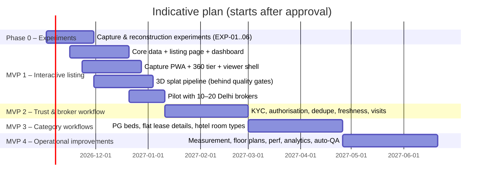

# MVP Roadmap

Sequencing rule: **prove one complete capture → view → enquiry loop works reliably before adding categories or advanced features.** Each MVP ends with an exit gate measured by the acceptance tests in `experiments-and-acceptance-tests.md`.

Durations assume a small team (2 full-stack, 1 graphics/CV engineer, 1 designer, 1 ops/field lead) and are indicative only.

## Phase 0: Experiments (before committing to the 3D tier)
Run EXP-01 to EXP-06 on 10 real Delhi units (3 PG rooms, 3 flats, 2 hotel rooms, 2 small bathrooms/kitchens).
**Exit gate:** a written go/no-go per room type for T2 (3D) versus T1 (360), with measured processing time and cost, and a device-tier performance table.

## MVP 1: Interactive rental listing
Scope (one category flow, generic "rent" listing usable for a flat or a whole PG room):
- Phone OTP accounts. A single-person org for each broker/owner.
- Create property → units → listing. Structured rent, deposit, **brokerage (required, can be "none")**, maintenance, amenities and availability date.
- Capture PWA: shot list for T0 photos, T1 360/phone-panorama capture, T2 walkthrough video upload (resumable).
- Processing: T1 tiling; T2 pipeline with quality gates and automatic fallback.
- Viewer: poster-first; room list; 360 and splat zones; typed hotspots (room label, amenity, door); details bottom sheet; fallbacks.
- Shareable SSR page with a WhatsApp preview.
- Enquiry with OTP, delivered to the broker by WhatsApp/SMS and an inbox. Price snapshot.
- "Still available?" one-tap reconfirm. Simple report button. Audit log for listing, price and availability changes.

**Out of scope:** KYC, dedupe, visits calendar, PG beds, hotels, measurements, live tours.

**Exit gate (AT-M1):**
- ≥ 50 published listings from ≥ 10 pilot brokers. Median capture-to-publish ≤ 6 h for 3D and ≤ 30 min for photos/360.
- ≥ 95% of tour opens render *something* (3D, 360 or photos) with no blank state. p75 3D first render ≤ 8 s on the reference Android over 4G.
- ≥ 1 enquiry per 25 listing views (baseline to beat later) and 0 enquiries lost (delivery receipts).

## MVP 2: Rental trust and broker workflow
- Broker identity checks (PAN, DigiLocker), with badges and explanation sheets.
- Property authorisations with owner confirmation; owner "claim" flow.
- Duplicate detection (address, geo, pHash) and an admin review queue.
- Freshness scheduler by category, stale/expired states, renter "not available" outcomes.
- Transparent charges enforcement and text moderation.
- Visit scheduling with states; outcomes (rented here/elsewhere/not).
- Moderation cases, decisions, appeals; audit viewer; org accounts with agents.

**Exit gate (AT-M2):** no badge shown without passed, unexpired checks (automated test plus a weekly audit sample). Stale listings hidden within 1 h of the deadline. Duplicate precision ≥ 90% and recall ≥ 80% on the labelled set. Median broker first response ≤ 2 h.

## MVP 3: Category-specific workflows
- **PG:** rooms by sharing type, bed-level availability, food plans, house rules, earliest-bed computation, 7-day freshness.
- **Flats:** lease terms, lock-in, notice, furnishing checklist, room-level zones, comparison of all-in cost.
- **Hotels:** room types with inventory count, nightly rate per date (manual entry or CSV), booking **requests**, deep link to the hotel engine, check-in/out rules, taxes shown separately.
- Search filters per category; compare view.

**Exit gate (AT-M3):** each category passes its end-to-end scenario (AT-PG-*, AT-APT-*, AT-HTL-*). PG bed availability accuracy ≥ 90% (measured through renter outcomes and mystery checks).

## MVP 4: Operational improvements
- Better processing: improved trainer settings, auto-exposure normalisation, floater cleanup, faster LOD build, per-room-type presets.
- Metric layer: RoomPlan / laser validation, validated dimensions, schematic floor plans, an in-viewer measuring tool for validated scenes only.
- Mobile performance work (WebGPU path evaluation, pixel-ratio policies, prefetching), free-walk navigation for larger units.
- Analytics dashboards: funnel by listing and broker, pipeline cost per zone.
- Automated capture QA in-app (live coverage and blur feedback).
- Optional: live video walkthrough, generated tour videos for WhatsApp/Instagram, channel-manager integration for hotels.

**Exit gate (AT-M4):** validated measurements within ±2% / ±5 cm on the test set. Re-capture rate below 10%. p75 3D first render ≤ 5 s.

## What we deliberately postpone
Payments and escrow, rent agreements and police-verification integration, VR, AI-generated staging, and robotics/data licensing (out of scope by mandate).
