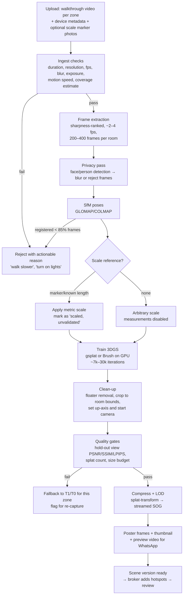

# Capture and Reconstruction Options

This document covers Phase 4 (the capture-to-listing workflow) and Phase 5 (technical options). Evidence IDs refer to `evidence-ledger.md`. Costs use **₹88 = US$1** (assumption) and exclude GST unless noted.

## 1. Key constraint: realism is not accuracy

3D Gaussian Splatting optimises for **how the scene looks from the captured viewpoints**. It does not optimise for metric geometry. A splat from phone video has an **arbitrary scale** and can contain floaters, warped walls behind furniture, and wrong geometry on mirrors, glass and blank walls. Nucleus's demos use XGRIDS rigs with LiDAR (E26, E50), which supply metric scale. Our MVP will mostly use phones, which do not.

**Rule:** visual walkthroughs and measurements are **separate products**. A walkthrough can ship without measurements. A measurement ships only after validation (see `rental-product-requirements.md` §6).

## 2. Options compared

Scores: ●●● good, ●● fair, ● poor. "Hardware cost" is per capture kit.

| Option | Visual quality | Geometric / metric accuracy | Capture difficulty | Processing cost | Device / viewer compatibility | Storage per 2BHK | Hardware cost | Licensing notes |
|---|---|---|---|---|---|---|---|---|
| **A. Smartphone photos** (guided shot list) | ●●● per photo, no spatial continuity | none | ●●● easy | ~₹0 | ●●● universal | 20–60 MB | ₹0 (broker's phone) | none |
| **B. Smartphone walkthrough video** (as video) | ●● | none | ●●● easy | transcoding only | ●●● | 100–300 MB source → 20–40 MB HLS | ₹0 | none |
| **C. 360° panoramas** (phone panorama or 360 camera), linked "street-view" style tour | ●●● from the capture points, nothing in between | ● (no metric data; jumps between points) | ●● place the camera at 1–2 points per room | ~₹0 (stitching on the camera or app) | ●●● (Pannellum / Photo Sphere Viewer, MIT, E58) | 5–15 MB per pano, 50–150 MB per flat | Phone: ₹0. Insta360 X5: ~₹55k (E61) | Viewers MIT/Apache |
| **D. 3DGS from smartphone video** (SfM + splat training) | ●●–●●● when captured well. Weak in small rooms, bathrooms, mirrors and low light. | ● arbitrary scale. ●● with a scale reference (ArUco/marker or a known dimension), still needs validation. | ●● needs a slow, overlapping walk. Coaching is required. | GPU ~20–60 min per scene (to be measured, EXP-06) | ●● needs WebGL2 and decent GPU/RAM. LOD streaming is essential. | Raw 1–3 GB. Published 15–80 MB (SOG, estimate). | ₹0 | COLMAP/GLOMAP BSD (E57). gsplat/Brush Apache-2.0 (E55). **Avoid Inria code (non-commercial, E56).** |
| **E. 3DGS from 360° video** (Insta360 X-series) | ●●● wider coverage per pass, better for tight rooms | ● / ●● like D | ●● one slow walk. Easier than a phone because of the field of view. | similar to D plus equirect→perspective pre-processing | ●● | Raw 2–6 GB | ~₹55k (E61) | Same toolchain. Nucleus's code lists `insta360` as a device (E27). Scaniverse paid tier accepts 360 input (E59). |
| **F. Phone app splats** (Scaniverse / Polycam / KIRI) then export | ●● | ● | ●●● app-guided | Done on device or in the vendor cloud | ●● (export PLY/SPZ into our viewer) | 20–200 MB | ₹0 plus subscription | **Commercial-use terms vary by tier. Must be confirmed per app (E59).** Vendor dependency. |
| **G. Smartphone LiDAR / depth** (iPhone Pro: RoomPlan, ARKit scene depth) | ●● mesh textures look "gamey". RoomPlan gives a parametric room, not visuals. | ●●● for room dimensions (anecdotal ~3–15 cm, E60) | ●● iPhone Pro only (a small share of Delhi brokers) | on-device | RoomPlan output → floor plan SVG/USDZ | small | iPhone Pro ₹1–1.5 lakh (if not already owned) | Apple frameworks, app must be iOS |
| **H. Dedicated spatial camera** (XGRIDS PortalCam / Lixel, Matterport Pro-class) | ●●● | ●●● metric LiDAR | ●●● walk once | Vendor software (LCC Studio) plus licences | ●● needs LOD streaming | 0.5–1 GB published (Nucleus: 117 MB streamed of a 0.9 GB PLY, E24/E26) | **~₹9–10 lakh** (E50) | Vendor software licences. LCC format is open (E51). |
| **I. Mesh-based reconstruction** (photogrammetry → textured mesh) | ●● poor on thin and reflective objects | ●● / ●●● with scale | ●● needs many photos | high CPU/GPU | ●●● any WebGL device (glTF) | 50–300 MB | ₹0 | OpenMVS (AGPL: avoid in a SaaS backend without legal review). COLMAP MVS (BSD). |

### Viewers and toolchains (reuse candidates)

| Component | Use | Licence | Status |
|---|---|---|---|
| **Spark** (sparkjsdev/spark) | 3DGS renderer for three.js. PLY/SPZ/SPLAT/KSPLAT/SOG. LOD streaming in 2.0. Used by Nucleus (E28). | MIT (E53) | Active (pushed Oct 2026) |
| **PlayCanvas engine + SuperSplat + splat-transform** | Alternative renderer and editor. Compress, decimate, streamed SOG (LOD). WebGPU path. | MIT (E54) | Active |
| **mkkellogg/GaussianSplats3D** | Older three.js splat viewer | MIT | Less active (last push Oct 2025) |
| **gsplat** (nerfstudio) / **Brush** | Training splats from SfM output | Apache-2.0 (E55) | Active |
| **COLMAP / GLOMAP** | Camera pose estimation (SfM) | BSD (E57) | Active |
| **Pannellum / Photo Sphere Viewer** | 360° panorama tours with hotspots | MIT (E58) | Active |
| **splatter.app / similar hosted LOD services** | Hosted splat streaming (Nucleus uses it, E23) | Commercial SaaS (E52) | Option to avoid building LOD hosting at first |
| **Apple RoomPlan** | LiDAR room dimensions → floor plan | Apple SDK | iOS-only |

## 3. Recommendation: a low-cost MVP capture stack

**Tiered capture.** Every listing gets Tier 0. Higher tiers are added when they pass the experiments.

| Tier | What | Who captures | When to use | Hardware |
|---|---|---|---|---|
| **T0: Photo set** (required) | Guided shot list: each room from 2 corners, bathroom, kitchen, view from the window, building entrance, electricity meter / water source if relevant. EXIF time and location kept server-side. | Broker or owner | Every listing | Phone |
| **T1: 360° room tour** | One or two 360° captures per room, linked by hotspots ("go to bedroom 2") | Broker (phone panorama mode) **or** a field capturer with a 360 camera | Default "immersive" tier for PGs and flats in MVP 1 | Phone, or Insta360 X-class (~₹55k) |
| **T2: 3D splat walkthrough** | One continuous slow walkthrough video per zone (room), from a phone or 360 camera, reconstructed with SfM + gsplat and streamed as LOD SOG | Trained field capturer at first, brokers later once the capture app has live guidance | When EXP-01/02 show acceptable quality for that room type | Phone or 360 camera |
| **T3: Metric layer** (optional) | iPhone Pro RoomPlan scan, **or** tape/laser measurements entered with photos of the reading, used to validate dimensions and draw a schematic floor plan | Field capturer | Flats where renters care about room sizes. Hotels (room size is a common question). | iPhone Pro / laser meter (~₹2–5k) |
| **T4: Dedicated rig** | XGRIDS-class | Partner studio | Only if experiments show T2 cannot meet the quality bar for a segment that pays for it (premium serviced apartments, hotels) | ₹9–10 lakh |

Why this order:
- **T1 (360) carries less risk than T2 (splats)**: universal device support, tiny processing cost, predictable quality, and simple capture. It already answers the renter's main questions: what does the room look like, how much light, condition, attached bath.
- **T2 adds continuous walking and "feel"**, but costs more to process, fails more often (small rooms, mirrors, low light), and needs a capable phone to view. It ships per room only after automated quality gates pass. Otherwise we fall back to T1.
- **Measurement is decoupled** (T3), so photorealism is never mistaken for accuracy.

## 4. Reconstruction pipeline (T2)

Implementation notes:
- **Hold-out evaluation:** keep ~5% of frames out of training and score PSNR/SSIM/LPIPS on them. This is the main automated quality gate (thresholds set in EXP-01).
- **Zone = room:** we reconstruct per room (or a small group of connected rooms), not the whole flat as one scene. This makes failures cheaper, assets smaller and navigation simpler, and matches the Nucleus zone pattern (E32).
- **Collision / navigation:** for MVP use **orbit + click-to-teleport between predefined viewpoints** rather than FPS walking with colliders. That avoids authoring collision geometry. Nucleus authors separate collider GLBs (E30), which costs labour.

## 5. Capture-to-listing workflow (Phase 4)

| # | Step | Automated? | Manual review? | Special hardware? |
|---|---|---|---|---|
| 1 | Broker/manager/owner creates a **Property** (address, geo-pin, category) and **Units** | Address normalisation, geocode, **duplicate-candidate check** (auto) | Duplicate conflicts → admin | No |
| 2 | Capture photos / video / 360 / optional scan | Capture app shot list, live checks (blur, exposure, orientation), offline queue and resumable upload | — | T0–T2: phone (or a 360 camera). T3: iPhone Pro or laser. T4: rig. |
| 3 | Validate quality and coverage | Per-room coverage checklist, blur/exposure scores, minimum shots, face detection | Borderline cases → capture QA (P2) | No |
| 4 | Reconstruct the scene (if T2) | Full pipeline §4 with automated gates | Spot-check sample (10%) in the early months | Cloud GPU |
| 5 | Create the browser walkthrough | Poster, LOD, links between zones, default camera | — | No |
| 6 | Add details, pricing, availability, hotspots | Form validation, charge completeness, required disclosures, text moderation (no prices in free text, no discriminatory terms) | — | No |
| 7 | Verification checks | OTP, KYC provider callbacks, document OCR, geo/time consistency of capture | **Document and authorisation review by admin** (§ `verification-and-trust-design.md`) | No |
| 8 | Publish with shareable link | Slug, OG image, sitemap. Listing state → `published`. | — | No |
| 9 | Renters inspect, compare, enquire, schedule visits | Notifications, slot booking | — | No |
| 10 | Update availability and status | Reminder pings (7/14/1 days per category), auto-expiry, renter "not available" feedback | Disputes → admin | No |

## 6. Decision rules: when to require more expensive capture

- Move a segment from T1 to T2 when EXP-01 shows ≥ 80% of rooms of that type passing quality gates from phone/360 capture, **and** EXP-07 shows renters prefer it (more enquiries per view, or fewer "not as shown" reports).
- Consider T4 rigs only if a paying segment (hotels / premium rentals) requires metric floor plans at scale **and** T3 (RoomPlan or manual measurement) is too slow, i.e. more than 20 min of field time per unit.
