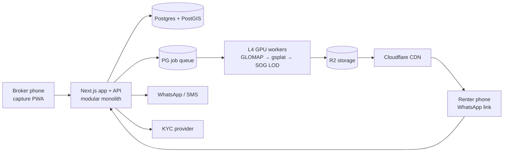

# Executive Summary: 3D Rental Platform for Delhi (PG · Flats · Hotels)

Status: **research and architecture complete. Implementation awaits approval.**
Date: 2026-10-15. Evidence IDs (E##) refer to `evidence-ledger.md`. Levels: V = verified by direct observation, R = reported, I = inferred.

## Documents

| # | Document | Contents |
|---|---|---|
| 1 | `executive-summary.md` | This file |
| 2 | `nucleus4d-public-feature-analysis.md` | What Nucleus4D does, observed vs claimed, rental relevance |
| 3 | `evidence-ledger.md` | Every source and observation with confidence levels |
| 4 | `rental-product-requirements.md` | Personas, journeys, category-specific requirements, honesty rules, NFRs |
| 5 | `capture-and-reconstruction-options.md` | Capture tiers, option comparison, pipeline, capture-to-listing workflow |
| 6 | `interactive-viewer-architecture.md` | Renderer choice, layouts, loading/fallback states, hotspots |
| 7 | `rental-data-model.md` | Property / Unit / Bed / Listing separation, ERD, lifecycle |
| 8 | `system-architecture.md` | Modules, stack, pipeline deployment, hotel integration, security |
| 9 | `verification-and-trust-design.md` | Check catalogue, badges, dedupe, freshness, moderation, audit |
| 10 | `cost-and-infrastructure-estimates.md` | Per-scene, per-listing and monthly cost model |
| 11 | `MVP-roadmap.md` | MVP 1–4 scope and exit gates |
| 12 | `experiments-and-acceptance-tests.md` | EXP-01..10 and measurable acceptance tests |
| 13 | `unknowns-and-risks.md` | Unknowns, risk register, assumptions |
| — | `evidence/` | Screenshots, public metadata JSON, sanitised network summary |

## 1. Which Nucleus4D capabilities matter for rentals

Relevant: **self-guided 3D walkthroughs viewable in a browser on any device** (V); **progressive streaming** so phones can load large scenes (V, E24–E25); **room/zone navigation** for multi-room properties (V, E32); **hotspots** with text and images (V, E31); **shareable, white-labelled links** (V, E20–E22); **live guided tours** (V, Zoom SDK, E35); **measurements and floor plans** (UI and data model V, accuracy unknown, E33–E34); **cinematic video** for social sharing (R/V code, E36).

Not present in Nucleus, and the core of our product: **rent, deposit, brokerage, availability, verification, enquiries and visits**. The demos are tours only, with no listing data (E40).

## 2. How their capture and viewing pipeline most likely works

All four public demos were captured with **XGRIDS LiDAR+camera rigs** (`captureDevice: "xgrid"`, E26). The pipeline stores a 0.9–1 GB Gaussian-splat PLY and an XGRIDS LCC result per zone. Separate lightweight **collider meshes and wall "segmentation boxes"** handle navigation (E30). Scenes are streamed through **splatter.app**: the Torrey house is 9.4M splats and 117 MB total, fetched progressively in ~0.85 MB chunks (E23–E24). A **Next.js + three.js r180 + Spark** viewer renders them with first-person walking, click-to-travel, hotspots, measurement and Zoom-based live tours (E28–E35). The page shows a poster image first and loads 3D only on tap (E21). Turnaround is claimed as 24–48 h (E03).

Unknown: how floor plans and measurements are produced, how accurate they are, and whether phone or 360 captures are used in production (the code supports `insta360` and `generic`, E27).

## 3. What we can reuse

| Need | Reuse | Licence |
|---|---|---|
| Splat rendering | **Spark** on three.js (as Nucleus does). PlayCanvas engine as fallback. | MIT (E53, E54) |
| Compression and LOD streaming | **splat-transform → streamed SOG** | MIT (E54) |
| Camera poses | **GLOMAP / COLMAP** | BSD (E57) |
| Splat training | **gsplat** or **Brush** (not Inria's research code, which is non-commercial, E56) | Apache-2.0 (E55) |
| 360 tours | **Photo Sphere Viewer** / Pannellum | MIT (E58) |
| Room dimensions | Apple **RoomPlan** (iPhone Pro) or laser plus manual validation | Apple SDK |
| Storage/CDN | **Cloudflare R2** (zero egress) | Commercial (E62) |

No custom 3D engine and no new 3D model training architecture are needed.

## 4. How to deliver an affordable renter-facing experience

- **Tiered capture:** photos are always required (T0). 360 room tours are the default immersive tier (T1, phone or a ~₹55k camera). 3D splats from phone/360 video are added per room only when automated quality gates pass (T2). A dedicated ₹9–10 lakh rig (T4) is not required unless experiments show it is necessary.
- **Mobile-first viewer:** poster first, then a capability probe, then 3D, 360 or photos. The price, availability and enquiry button stay visible next to the walkthrough. Room-by-room navigation instead of free walking in MVP.
- **Honesty rules:** no dimensions unless validated against a physical reference (±2% / ±5 cm). Declared areas are labelled "as declared". Hotel scenes are labelled "representative room".
- **Estimated cost:** about **₹125–430 processing per 3D property**, **under ₹2 for a 360 tour**, field capture ₹250–500 when we do it ourselves, near-zero delivery cost on R2. A pilot month with 500 new listings comes to roughly **₹1.7–2.7 lakh all-in, or ₹335–550 per listing** (assumptions in the cost doc, to be confirmed by EXP-06).

## 5. Broker and listing verification

- **Every check is a separate record** with method, evidence, decider and expiry. Badges are derived only from checks that passed and have not expired, never from listing text.
- **Broker:** phone OTP, PAN verification, and DigiLocker-consented identity, with no raw Aadhaar stored. Delhi RERA agent number shown where it exists (its applicability to rental brokers is unclear, E70).
- **Property:** a broker needs an **owner/operator authorisation** with owner phone confirmation plus an ownership, lease or registration document before publishing. Several non-exclusive brokers are allowed, linked to one property.
- **Duplicates:** address normalisation, a 75 m geo radius, trigram matching and perceptual photo hashes. Results are clustered and reviewed, never auto-merged. Stolen photos at a different address raise a case.
- **Freshness:** reconfirmation every 7 days for PGs, 14 days for flats and daily for hotels, via one-tap WhatsApp. Listings go stale and then expire. Renter "not available" reports pause a listing.
- **Charges:** structured deposit and brokerage are mandatory before publishing (brokerage can be "none"). Each enquiry stores a price snapshot. Price plans are versioned.
- **Moderation and audit:** cases, SLAs, appeals reviewed by a second moderator, and a hash-chained append-only audit log.

## 6. Recommended MVP architecture

A **modular monolith**: Next.js (SSR listing pages plus a lazy-loaded Spark viewer) with TypeScript APIs, **PostgreSQL + PostGIS**, a **Postgres-backed job queue**, **R2 + Cloudflare CDN**, and **on-demand L4 GPU workers** (Python: ffmpeg, GLOMAP, gsplat, splat-transform). It also uses phone OTP, WhatsApp Business messaging, a licensed KYC provider and PostHog analytics, deployed in an Indian cloud region. See `system-architecture.md`.

## 7. Expected capture and processing costs (summary)

| Item | Estimate |
|---|---|
| 3D processing per zone (L4) | ₹16–55 (20–60 GPU-min) |
| 3D processing per 2BHK (6 zones, +30% retries) | ₹125–430 |
| 360 tour processing | < ₹2 per property |
| Field capture by the platform | ₹250–500 per property |
| 360 camera | ~₹55k one-time (E61) |
| Dedicated rig (not recommended for MVP) | ~₹9–10 lakh (E50) |
| Delivery (R2, 100k sessions/month) | ~₹200 per month |
| Fixed infrastructure | ₹15k–40k per month |

## 8. The five highest-priority engineering tasks

1. **Reconstruction spike on real Delhi rooms** (EXP-01/02/06): phone and 360 video → GLOMAP → gsplat/Brush → splat-transform streamed SOG, with hold-out quality gates and per-stage cost logging on 10 units. *This sets the T1 vs T2 decision.*
2. **Viewer shell and device benchmark** (EXP-03): a Next.js listing page with poster-first loading, a lazy Spark viewer, a capability probe, LOD budgets, 360/photo fallbacks and a bottom-sheet price block. Benchmark against PlayCanvas on the low and mid-range Android matrix.
3. **Core data model and publishing rules**: Property / Unit / Bed / Listing separation, versioned price plans with mandatory deposit and brokerage, availability, listing state machine, and an append-only audit log enforced at the database level.
4. **Capture PWA**: a guided per-room shot list, live blur/exposure checks, resumable multipart uploads, and capture-session metadata (device, time, location) that will later support the "taken on-site" check.
5. **Enquiry and freshness loop**: OTP enquiries with price snapshots, WhatsApp/SMS delivery with receipts, and one-tap "still available?" reconfirmation with automatic stale and expired states.

## 9. Decisions requested before implementation

1. Approve the **tiered capture strategy** (360 default, 3D gated by experiments), or require 3D for every listing.
2. Approve Phase 0 experiments (about 4 weeks, 10 units, roughly ₹1–1.5 lakh including a 360 camera and an iPhone Pro if not already available) **before** MVP 1 build.
3. Confirm the hosting region and provider preference (AWS Mumbai vs Indian cloud vs Vercel for speed).
4. Engage counsel on RERA scope, the KYC/Aadhaar flow, DPDP notices and tenant-preference policy before MVP 2.
