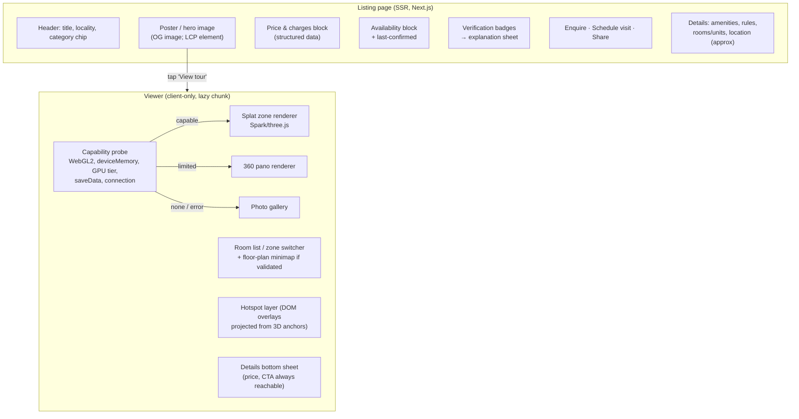
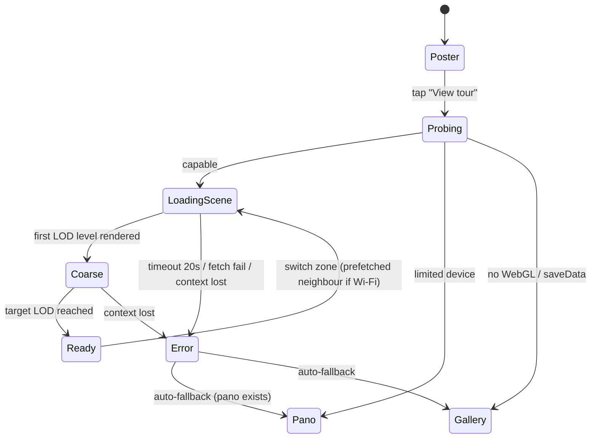

# Interactive Viewer Architecture

Goal: a renter-facing viewer that shows rental facts and the walkthrough together, works on mid-range Android phones over 4G, and degrades gracefully. **Build on existing renderers. Do not write a custom engine.**

## 1. Renderer decision

| Option | For | Against | Verdict |
|---|---|---|---|
| **Spark on three.js** (MIT) | Nucleus uses it in production (E28). Reads PLY/SPZ/SOG. LOD streaming in 2.0. three.js is familiar to web devs and handles hotspots and overlays easily. WebXR helpers. | Spark 2.0 LOD is recent (Apr 2026), so the API may still change. WebGL2 only. | **Primary choice** |
| **PlayCanvas engine** (MIT) | Mature streamed-SOG LOD pipeline (splat-transform), a WebGPU path with large speed-ups reported (E54), the SuperSplat editor for clean-up. | A different scene graph from three.js. Heavier engine. | **Fallback / benchmark candidate.** Run EXP-03 on both. |
| mkkellogg GaussianSplats3D (MIT) | Simple | Less active | Not chosen |
| Hosted viewer (splatter.app, etc.) | Zero hosting work. LOD and CDN included (E52). | Vendor lock-in, per-scene pricing (Business $249/mo for 100 scenes), less control over UX | Possible bridge for the first 100 scenes only if self-hosted LOD slips |
| Custom WebGPU engine | — | Months of work. No product advantage. | **Rejected** |

360° tier (T1): **Photo Sphere Viewer** (MIT, active, virtual-tour and markers plugins) or Pannellum (MIT). One viewer shell switches between "pano" and "splat" zone types.

## 2. Page architecture

Principles:
- **Poster first**, as Nucleus does (E21): the listing page LCP is a static image. The viewer JavaScript (three.js + Spark, roughly 600 KB–1 MB gzipped, to be measured) loads only when the renter taps.
- **Facts are never hidden behind 3D.** On mobile a persistent bottom sheet shows rent / deposit / brokerage plus the CTA, and expands to the full details. On desktop it is a side panel. Nucleus's demos show no listing data in the viewer (E40). That is the gap we close.
- **Room list instead of free walking first.** Renters think in rooms ("show me the bathroom"). Each zone is a room with a start camera. Moving between zones is a tap.

## 3. Navigation model

| Mode | Desktop | Mobile | MVP? |
|---|---|---|---|
| Orbit / look-around from the zone's start viewpoint | drag + wheel | one-finger drag, pinch to zoom (FOV) | **MVP 1** |
| Teleport to predefined viewpoints within a zone ("go to window") | click a ring marker | tap | **MVP 1** |
| Zone switch (room list, in-scene door hotspots) | click | tap / swipe the room chip | **MVP 1** |
| Free walk (WASD / joystick) with collision | keys | virtual joystick | MVP 4 (needs collider authoring, as Nucleus does, E29/E30) |
| Gyro "magic window" | — | optional toggle | MVP 4 |
| Guided auto-tour (camera rail) / exported video | play button | play button | MVP 4 (video export first, for WhatsApp) |

Camera constraints: clamp orbit radius and pitch to stay inside the room's captured volume, so the camera never flies outside walls into reconstruction garbage.

## 4. Hotspots and labels

Hotspot types (typed, not free-form):
`room_label`, `amenity` (AC, geyser, wardrobe, Wi-Fi router…), `issue_disclosure` (e.g. "seepage repaired Aug 2026"), `door_to_zone`, `view` (window view), `measurement` (validated only), `info`.

Each hotspot stores `{zone_id, position[3], normal[3]?, type, title, body, media_ids[], visibility}`. This mirrors the Nucleus POI structure (E31) but adds a type and governance: an `issue_disclosure` cannot be removed by the broker once a renter has reported it, only by admin.

Rendering: DOM overlay elements positioned by projecting the 3D anchor each frame and hidden when occluded (depth test against a coarse proxy or a distance threshold). DOM keeps text accessible and selectable.

Authoring (broker dashboard): tap on the scene → raycast against the splat (Spark supports picking) or the pano sphere → pick a type → fill a form. A preview runs before publishing.

## 5. Loading, streaming and states

- **Formats:** publish **streamed SOG** (LOD chunks plus an index) produced by splat-transform. Spark and PlayCanvas both read SOG (E53/E54). Keep the source PLY in cold storage.
- **Budgets** (enforced by the pipeline, verified by EXP-03): first LOD ≤ 3 MB per zone, total per zone ≤ 25 MB, splat count per zone ≤ 1.5M at top LOD for mobile, with a desktop-only top level allowed.
- **Device tiers:** `navigator.deviceMemory`, the WebGL renderer string and a 1-second warm-up frame-time probe set a max LOD. Lower the pixel ratio before the LOD.
- **Network hints:** respect `Save-Data` and `effectiveType` (2g/3g → pano/gallery by default, with a "load 3D anyway" option).
- **Loading UI:** show the poster blurred under a progress ring, then the coarse scene. Nucleus does the same (E25). Always show "Switch to photos" during loading.
- **Errors:** WebGL context loss, OOM and timeouts are caught → auto-fallback, plus an anonymous telemetry event. A renter never sees a blank canvas.
- **Caching:** immutable, content-hashed URLs for scene chunks. Long `Cache-Control`. A service worker caches the poster and the first LOD of shortlisted listings.

## 6. Layouts

**Mobile (≤ 600 px):** full-bleed viewer. Top: back, room chip ("Bedroom 1 ▾"). Bottom: a collapsible sheet with ₹ rent · deposit · brokerage · "Available from 1 Nov · confirmed 2d ago" · [Enquire] [Visit]. Floating: recenter and photos/360/3D toggle. Tap targets ≥ 44 px.

**Desktop:** viewer on the left (≈65%), sticky details panel on the right, a room strip under the viewer.

**Consistency rule:** one shared `PriceBlock` component renders charges everywhere (search cards, listing page, viewer sheet, compare table, enquiry confirmation) from the same API object, so numbers never diverge.

## 7. Sharing

- `/{city}/{category}/{locality}/{listing-slug}-{shortId}` canonical URL, with SSR-rendered price and availability for SEO and link previews.
- Deep links: `?zone=bedroom-1&view=window` open the tour at a room.
- WhatsApp preview: OG image = poster with a price overlay rendered server-side (rent + "3D tour" badge).
- An embed iframe (`/embed/{listingId}`) for broker websites, rate-limited and watermarked with the listing ID.

## 8. Analytics events (viewer)

`listing_view`, `tour_open`, `tour_capability_tier`, `tour_first_render_ms`, `tour_ready_ms`, `tour_fallback(reason)`, `zone_view(zone, dwell_ms)`, `hotspot_open(type)`, `share_click(channel)`, `enquiry_start`, `enquiry_submit`, `visit_request`. Nucleus emits a comparable set (E38). Ours adds performance and fallback events for the mobile acceptance criteria.

## 9. What we explicitly do not build in MVP

VR/AR (WebXR), multi-user live co-browsing (Nucleus uses the Zoom SDK, E35. We use a WhatsApp video call link first), cinematic video generation, free-walk collision, and an in-viewer measurement tool.
