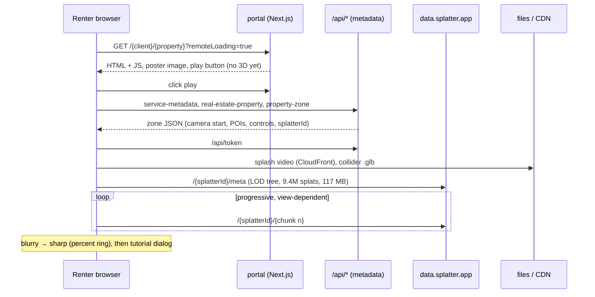
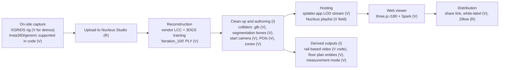

# Nucleus4D: Public Feature Analysis (rental-relevant only)

Scope: only the capabilities relevant to renting PGs, hotels and flats. Robotics, physical AI datasets, simulation and industrial uses are excluded on purpose. Evidence IDs (E##) refer to `evidence-ledger.md`.

## 1. Summary

Nucleus4D runs a **capture service plus hosted 3D Gaussian Splatting tours**. The four public demos we inspected were all captured with **XGRIDS handheld LiDAR+camera hardware** (E26). They are reconstructed into Gaussian splats, streamed progressively through **splatter.app** (E23–E25), and rendered in a **Next.js + three.js + Spark** web viewer (E20, E28). The viewer offers first-person walking with collision, click-to-travel, hotspots, multi-zone navigation, a measurement mode, floor-plan/minimap entities, and live co-browsing tours over the **Zoom Video SDK** (E29–E35).

Almost all of this is built from components that are **publicly available and permissively licensed** (three.js, Spark, splat streaming services/formats). The proprietary value sits in the operational pipeline: capture, cleaning, collider and segmentation authoring, a hosting/publishing CMS, distribution integrations (Zillow), and the capture workforce.

## 2. Capability matrix

| Capability | What we found | Level | Rental relevance |
|---|---|---|---|
| **Capture** | Homepage: one walkthrough with a "capture rig" (E03). All 4 demos are `xgrid` (E26). Code also lists `insta360` and `generic` devices (E27). Company aspiration: "ordinary phone or camera" (E13). | V/R/I | High. Hardware cost decides affordability in Delhi. |
| **Reconstruction** | 3DGS (E07). XGRIDS PLY (`iteration_100/point_cloud.ply`, 0.9–1.0 GB) and LCC outputs are stored per zone (E26). Processing "under two hours" (E04) versus "24–48 h" delivery (E03). | V/R | High |
| **Scene format and streaming** | Splatter LOD streaming: 9.4M splats, ~117 MB total, fetched in ~0.85 MB chunks progressively (E24). A Nucleus-native HLS-like playlist also exists (E43). | V | High. This is what makes mobile viewing feasible. |
| **Browser navigation** | FPS walk (keyboard, mobile joystick), click-to-travel "halo", collision capsule, recenter button, help, tutorial (E29, E30, E39). | V | High |
| **Multi-room / multi-zone** | One splat per zone, with a zone dropdown, portals and layouts (E32). | V | High. A PG has many rooms; a hotel has room categories. |
| **Hotspots** | POIs with title, description, image gallery, icon and 3D placement (E31). The homepage claims text, audio and video (E02). | V/R | High (amenities, "AC here", "attached bath") |
| **Measurements** | A two-point measurement UI exists (E34). The homepage says hospitality planners "check capacities against measurements" (E02). Accuracy is unknown. | V/U | Medium. Must be validated before showing to renters. |
| **Floor plans** | Floor-plan, minimap and segmentation-texture entities exist (E33). The generation method is unknown. Hidden in the demos inspected. | V/U | Medium |
| **Cinematic video** | Claimed: "Pick a route, a length and an aspect ratio", including vertical for social media (E02). Camera "rails" exist in code (E36). | R/V | Medium (WhatsApp/Instagram sharing in India) |
| **Live guided tour** | Zoom Video SDK, host controls the view and attendees see a cursor (E05, E35). | V/R | Medium–High (broker shows a flat to an out-of-town renter) |
| **Hosting and sharing** | Per-client URLs, white-label branding, splash video, partner portal (E20–E22, E12). Distribution into Zillow and realtor.com (E06). | V/R | High (shareable link on WhatsApp) |
| **Analytics** | Session and interaction events, referrer classification (E38). Homepage: "visitor insights" (E02). | V | Medium |
| **Mobile** | Same viewer at 390 px with a full-screen scene, top zone pill and two floating buttons (E40). We have no frame-rate data (headless software rendering). | V | High |
| **Listing data (price, availability, contact)** | **None** in the demos. The viewer is a tour, not a listing page (E40). | V | This is the gap our product fills. |
| **Verification / trust** | None observed. | V | This is the gap our product fills. |
| **Pricing** | Not public (E12). A podcast reports $0.03/sq ft/listing/year (E11, low confidence). | R | Benchmark only |

## 3. Observed viewer behaviour (desktop and mobile demo)

Observations (E21–E25, E39–E41):
- **Poster-first loading** keeps the first paint cheap and avoids loading a 3D scene for visitors who only skim. We should copy this pattern.
- **Progressive LOD** shows a usable scene early, but the coarse level is visibly blurry, as in screenshot 02.
- **Quality** (screenshot 03): photoreal overall. Artefacts appear at thin edges (cabinet edges, smeared wall texture), on ceiling textures and on pendant lights. That is typical for 3DGS and acceptable for renters judging layout, light and condition. It is **not** suitable for reading fine print or judging small defects such as dampness.
- **No information panel**: the demos are immersive-only. A renter cannot see rent, deposit or contact details next to the scene.

## 4. How the capture → view pipeline most likely works

Verified data points are marked (V); everything else is inference (I).

Why we think so:
- Collider GLBs that are tiny (65 KB) and segmentation boxes labelled `wall` (E30) point to **separate simplified geometry** for collisions and possibly for floor plans. The splat itself is not used for physics. The JS references to RANSAC suggest plane fitting on point/LiDAR data (I).
- XGRIDS hardware provides **metric LiDAR scale**, which is what makes measurements credible (I). A phone-video splat does not carry reliable scale.
- `iteration_100` and 0.9–1.0 GB PLY files point to splats exported from the XGRIDS LCC toolchain, or a training step seeded from it (I). We do **not** know whether Nucleus trains its own splats.

## 5. Publishing flow for an owner or broker (as publicly described)

1. Book a demo or become a partner (E12).
2. Capture the property in one walkthrough with the rig, done by Nucleus or a partner photographer (E03, E12).
3. Upload to Nucleus Studio (`studio.nucleus4d.com`, login only).
4. After 24–48 h: tour link, live-showing link, video, floor plan and measurements (E03).
5. Share the white-labelled link and/or publish to Zillow (E06, E22).

The publisher **does not reconstruct anything themselves**. The service model is "capture professional + cloud processing + hosted tour".

## 6. What is confirmed vs unknown

**Confirmed (V):** 3DGS tours. The XGRIDS capture on the demos. Splatter streaming. three.js + Spark. FPS/click-to-travel navigation with colliders. POIs. Multi-zone. A measurement UI. Floor-plan entities. Zoom-based live tours. White-labelling. A mobile layout. Analytics events.

**Reported only (R):** turnaround (2 h vs 24–48 h), cinematic video generation, Zillow approval, square-footage totals, the $0.03/sq ft price.

**Unknown (U):**
- How floor plans and measurements are produced, and their error bounds.
- Whether phone or Insta360 captures are used in production, and at what quality.
- Their own training pipeline (if any) versus vendor software.
- Typical scene sizes for small units (a 10 m² PG room).
- Real mobile frame rate and memory use on low-end Android.
- How live-tour attendee limits work.
- Content moderation, privacy blurring and any listing verification (none observed).

## 7. Implications for our rental product

1. **Reuse, don't reinvent.** The renderer (Spark / PlayCanvas), splat formats (SOG/SPZ) and streaming are open or commercially available. No proprietary algorithm is needed for an MVP.
2. **Hardware is their cost driver.** XGRIDS-class rigs (~₹9–10 lakh, E50) do not fit a Delhi PG at ₹8–15k rent. Our MVP has to test whether phone and 360-camera capture is "good enough" (see `experiments-and-acceptance-tests.md`).
3. **Measurement credibility comes from metric sensors.** Without LiDAR or a validated scale reference we must not show dimensions (see `capture-and-reconstruction-options.md`).
4. **The listing layer is missing in Nucleus.** Price, availability, verification, enquiry and visits are where a rental product differentiates.
5. **Poster-first + progressive LOD + zone-per-room** is the viewer pattern to adopt.
