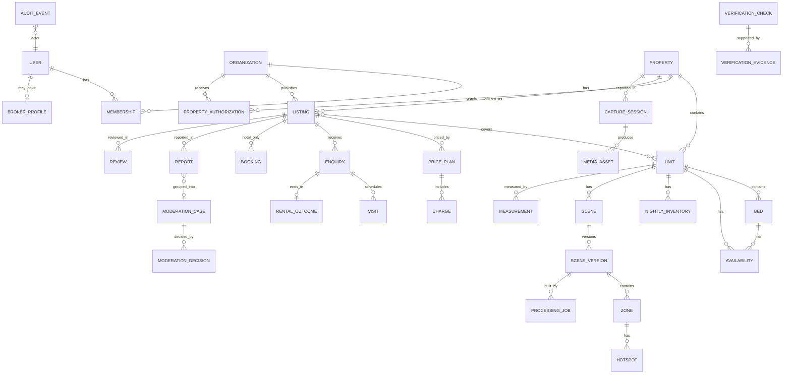
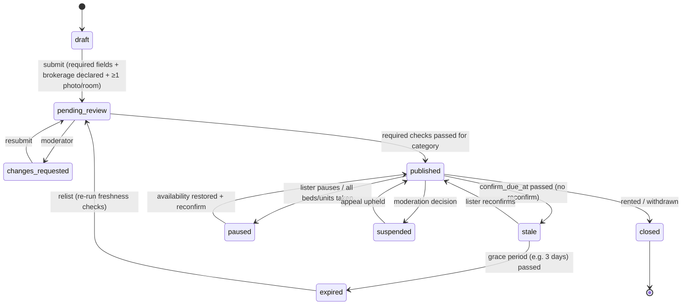

# Rental Data Model

Target: PostgreSQL 16+ with PostGIS. Conventions: `id uuid` primary keys, `created_at` / `updated_at` timestamps, money as `bigint` **paise** with a `currency char(3) default 'INR'`, soft deletes only where noted. **Audit-relevant tables are append-only or versioned.**

## 1. Core separation

```
Organization ─┬─ Broker/Agent (Membership)
              │
Property (physical place, one per real-world building/house/PG/hotel)
   └─ Unit (rentable physical space: flat, PG room, hotel room-type, …)
        └─ Bed (PG only)
Listing (a market offer by one authorised lister for one Property/Unit scope)
   ├─ PricePlan + Charges
   ├─ AvailabilityRules / Inventory
   └─ media selection (scene versions, photos)
```

- **Property ≠ Listing.** One property can have several listings: different units, or the same unit by more than one authorised broker. Duplicate detection *links* listings to the same property and never silently merges them.
- **Unit ≠ Listing.** A unit exists whether or not it is on the market. Its media and scenes belong to the unit and can be reused across listings.
- **Verification status is not a column on the listing.** It is derived from `verification_checks` that passed and have not expired. Marketing text lives in `listing.description` and is never used for trust decisions.

## 2. Entity-relationship diagram



## 3. Tables

### 3.1 Identity and organisations
| Table | Key columns | Notes |
|---|---|---|
| `users` | id, phone_e164 (unique, verified_at), email?, name, preferred_lang, roles[] (`renter`,`lister`,`admin`,`moderator`), status | Phone OTP is the primary login. No Aadhaar number stored. |
| `organizations` | id, type (`brokerage`,`pg_operator`,`property_manager`,`hotel`,`owner_individual`), legal_name, display_name, gstin?, rera_agent_no?, city, status | An individual owner gets a single-person org, so the model stays uniform. |
| `memberships` | org_id, user_id, role (`owner`,`admin`,`agent`), status | A broker can belong to several orgs. |
| `broker_profiles` | user_id, display_name, photo_asset_id, localities[], languages[], years_active?, public_phone_masked | Public profile. Contact goes through the platform relay. |

### 3.2 Physical inventory
| Table | Key columns | Notes |
|---|---|---|
| `properties` | id, category_primary (`pg`,`apartment`,`house`,`hotel`,`guesthouse`), name?, address_line, locality_id, city, pincode, geo (PostGIS point), geo_precision, building_name?, floors_total?, normalized_address_hash, dedupe_cluster_id?, created_by_org_id, status (`draft`,`active`,`archived`,`merged_into`) | One per physical place. `dedupe_cluster_id` groups suspected duplicates. |
| `units` | id, property_id, kind (`flat`,`independent_floor`,`house`,`pg_room`,`hotel_room_type`,`room_in_flat`), label ("Flat 3B", "Room 204", "Deluxe"), floor?, bhk?, bathrooms?, attached_bath?, ac?, furnishing?, sharing_capacity? (PG), max_occupancy? (hotel), inventory_count? (hotel room-type), declared_area_sqft?, attributes jsonb (typed per kind, validated by JSON schema) | A hotel *room type* is a unit with `inventory_count`. |
| `beds` | id, unit_id, label ("A","B"), status (`vacant`,`occupied`,`notice`,`reserved`,`blocked`), status_since, notice_until?, reserved_until? | PG only. |
| `amenities` / `unit_amenities` / `property_amenities` | code (`wifi`,`ac`,`geyser`,`food`,`laundry`,`power_backup`,`cctv`,`lift`,`parking`…), detail jsonb | A controlled vocabulary. |
| `house_rules` | property_id or unit_id, gender_policy?, visitors, curfew_time?, smoking, alcohol, pets, food_policy, notice_period_days, lock_in_months, tenant_preference_stated? | Shown factually as the owner's policy. Free text is moderated. |

### 3.3 Authorisation
| Table | Key columns | Notes |
|---|---|---|
| `property_authorizations` | id, property_id, unit_ids[]?, org_id, basis (`owner_self`,`owner_mandate`,`operator_lease`,`hotel_management`), exclusive bool, valid_from, valid_until, status (`pending`,`active`,`revoked`,`expired`,`rejected`), owner_contact_id? | Lets a broker/org market a property. **Required before a listing can be published.** Multiple non-exclusive authorisations are allowed. |
| `owner_contacts` | id, property_id, name, phone_e164, relationship, consent_to_contact_at | Used for the owner confirmation call/OTP. Never shown publicly. |

### 3.4 Listings, pricing and availability
| Table | Key columns | Notes |
|---|---|---|
| `listings` | id, short_id, slug, property_id, org_id, lister_user_id, authorization_id, category (`pg`,`rent`,`short_stay`), scope (`whole_property`,`units`,`beds`,`room_types`), title, description (marketing, moderated), status (§4), published_at, last_confirmed_at, confirm_due_at, expires_at, visibility (`public`,`unlisted`) | |
| `listing_units` | listing_id, unit_id | Which units this offer covers. |
| `price_plans` | id, listing_id, unit_id?, applies_to (`bed_single`,`bed_double`,`bed_triple`,`unit_monthly`,`room_type_nightly`), base_amount_paise, period (`month`,`night`), occupancy?, meal_plan?, effective_from, effective_to? | **Versioned**: never updated in place, a new row supersedes. History is kept for disputes. |
| `charges` | id, price_plan_id, code (`security_deposit`,`brokerage`,`maintenance`,`electricity`,`water`,`food`,`admission_fee`,`lock_in_penalty`,`parking`,`extra_bed`,`tax`), mode (`fixed`,`months_of_rent`,`percent`,`metered`,`included`,`none`), amount_paise?, months?, percent?, unit_note?, recurrence (`one_time`,`monthly`,`nightly`), refundable bool, mandatory bool | Brokerage **must** have a row (it can be `none`) before publish. |
| `availability` | id, unit_id?, bed_id?, available_from date, available_until?, min_lease_months?, status, source (`lister`,`renter_report`,`integration`), confirmed_at, confirmed_by | PG and flats. |
| `nightly_inventory` | unit_id (room type), date, available_count, rate_paise?, min_stay?, closed_to_arrival bool, source, synced_at | Hotels. A partition by month is suggested. |
| `booking_rules` | listing_id, check_in_time?, check_out_time?, cancellation_policy jsonb, id_required, couples_policy?, token_amount_paise? | |

### 3.5 Capture, scenes and media
| Table | Key columns | Notes |
|---|---|---|
| `capture_sessions` | id, property_id, unit_id?, captured_by_user_id, device_model, app_version, started_at, ended_at, geo_start?, tier (`T0`..`T4`), status | Device and geo/time metadata also support capture-authenticity checks. |
| `media_assets` | id, capture_session_id?, owner_org_id, kind (`photo`,`video`,`pano360`,`splat_source`,`splat_published`,`poster`,`floorplan_image`,`document`), storage_key, bytes, sha256, phash?, width?, height?, duration_s?, exif jsonb (stripped from public copies), privacy_status (`pending`,`blurred`,`clean`,`rejected`), visibility (`private`,`public`), zone_hint? | `phash` supports duplicate detection. Documents are never public. |
| `scenes` | id, unit_id, kind (`pano_tour`,`splat`), current_version_id | |
| `scene_versions` | id, scene_id, version, pipeline (`pano`,`gsplat`,`brush`,`import_ply`,`vendor_lcc`), status (`processing`,`failed`,`qa_failed`,`ready`,`published`,`retired`), metrics jsonb (psnr, ssim, lpips, splat_count, bytes_by_lod), scale_status (`arbitrary`,`scaled_unvalidated`,`validated`), lod_index_key, poster_asset_id, created_from_session_id | Immutable once `ready`. |
| `zones` | id, scene_version_id, label ("Bedroom 1"), room_type, start_camera jsonb, bounds jsonb, splat_key? / pano_asset_id?, order | One room = one zone (pattern seen in Nucleus, E32). |
| `hotspots` | id, zone_id, type (`room_label`,`amenity`,`issue_disclosure`,`door_to_zone`,`view`,`measurement`,`info`), position, target_zone_id?, title, body, media_ids[], created_by, locked bool | `issue_disclosure` hotspots are locked after a renter report. |
| `processing_jobs` | id, scene_version_id, stage (`ingest`,`frames`,`privacy`,`sfm`,`train`,`cleanup`,`qa`,`compress`,`poster`), status, attempts, worker_id, gpu_type, started_at, finished_at, cost_estimate_paise, log_key, error_code | Also feeds the cost analytics. |
| `measurements` | id, unit_id, zone_id?, kind (`room_length`,`room_width`,`area`,`ceiling_height`), value_mm, method (`roomplan`,`laser`,`tape`,`scaled_splat`,`declared`), validation_status (`unvalidated`,`validated`,`rejected`), reference_value_mm?, tolerance_mm?, validated_by?, evidence_asset_ids[] | Only `validated` rows are rendered as numbers (R-MEAS-1). |
| `floor_plans` | id, unit_id, source (`roomplan`,`manual_drawn`,`vendor`), asset_id, validation_status | |

### 3.6 Enquiries, visits, outcomes, bookings
| Table | Key columns | Notes |
|---|---|---|
| `enquiries` | id, listing_id, unit_id?, bed_id?, renter_user_id, move_in_date?, stay_from?/stay_to? (hotel), occupants, budget_ack bool, message, channel (`web`,`whatsapp`), status (`new`,`responded`,`visit_scheduled`,`closed_won`,`closed_lost`,`spam`), assigned_user_id, first_response_at | Pricing **snapshot** stored in `enquiry_price_snapshots` at submission (dispute evidence). |
| `enquiry_messages` | enquiry_id, sender (`renter`,`lister`,`system`), body, sent_via, created_at | Relay. Masked phone numbers until both parties consent. |
| `visits` | id, enquiry_id, mode (`in_person`,`video`), slot_start, slot_end, status (`proposed`,`confirmed`,`completed`,`no_show_renter`,`no_show_lister`,`cancelled_by_*`), check_in_geo? (optional, consented), notes | |
| `rental_outcomes` | enquiry_id, outcome (`rented_here`,`rented_elsewhere`,`not_rented`,`listing_unavailable`,`misleading`), reported_by, reported_at, final_rent_paise?, brokerage_paid_paise? | Feeds freshness and trust scores. |
| `bookings` | id, listing_id, unit_id (room type), renter_user_id, stay_from, stay_to, guests, quoted_total_paise, status (`requested`,`confirmed`,`cancelled`,`checked_in`,`completed`,`no_show`), external_ref?, source (`enquiry`,`deeplink`,`channel_manager`) | Hotels. The MVP stores **requests** only, no payments. |

### 3.7 Trust: verification, reports, moderation, audit
| Table | Key columns | Notes |
|---|---|---|
| `verification_checks` | id, subject_type (`user`,`organization`,`property`,`authorization`,`listing`,`capture_session`), subject_id, check_type (§ trust doc), status (`pending`,`passed`,`failed`,`expired`,`revoked`,`needs_review`), method (`automated`,`provider`,`manual`), provider?, provider_ref?, decided_by?, decided_at, expires_at, reason_code? | **Badges derive only from `passed` and not-expired rows.** |
| `verification_evidence` | id, check_id, kind (`document_image`,`provider_response`,`call_record`,`geo_capture`,`note`), storage_key (encrypted bucket), sha256, redaction_status, retention_until | Access-controlled. Retention follows the DPDP-aligned policy. |
| `reports` | id, listing_id?, broker_user_id?, reporter_user_id?, reason (`not_available`,`fake_photos`,`wrong_price`,`hidden_charges`,`broker_misconduct`,`unauthorised_listing`,`discrimination`,`safety`,`other`), details, evidence_asset_ids[], status | |
| `moderation_cases` | id, kind (`report`,`dispute`,`duplicate`,`verification_appeal`), subject refs, priority, status (`open`,`awaiting_party`,`decided`,`appealed`,`closed`), assignee_id, sla_due_at | |
| `moderation_decisions` | id, case_id, decision (`no_action`,`edit_required`,`suspend_listing`,`remove_listing`,`suspend_user`,`revoke_verification`,`merge_property`,`unmerge_property`), rationale, decided_by, decided_at, appeal_of? | Immutable. |
| `reviews` | id, subject (`listing`,`broker`,`property`), author_user_id, enquiry_id (**required**, i.e. only after a real enquiry/visit), rating, text, status | Prevents drive-by fake reviews. |
| `audit_events` | id (bigserial), occurred_at, actor_user_id?, actor_role, action, subject_type, subject_id, before jsonb?, after jsonb?, ip_hash?, prev_hash, hash | **Append-only.** Hash-chained (`hash = sha256(prev_hash ‖ canonical(row))`). DB role has INSERT only. |

### 3.8 Analytics (separate schema / warehouse)
`events(event_name, occurred_at, anon_id, user_id?, listing_id?, zone_id?, props jsonb)`. Aggregated daily into `listing_funnel_daily(listing_id, date, views, tour_opens, enquiries, visits, outcomes_won)`.

## 4. Listing lifecycle



## 5. Category modelling in practice

| Concept | PG | Flat | Hotel |
|---|---|---|---|
| `listing.scope` | `beds` (or `units` for full rooms) | `units` | `room_types` |
| Unit kind | `pg_room` + `beds` | `flat` / `house` / `room_in_flat` | `hotel_room_type` (inventory_count) |
| Price plan | per occupancy (`bed_single/double/triple`), `period=month` | `unit_monthly` | `room_type_nightly`, per date via `nightly_inventory.rate` |
| Availability | `beds.status` + `availability(bed_id)` | `availability(unit_id)` | `nightly_inventory` |
| Transaction | enquiry → visit → outcome (+ token, offline) | enquiry → visit → outcome | enquiry/booking request → booking |
| Freshness interval | 7 days | 14 days | 1 day or integration sync ≤ 15 min |

## 6. Key constraints (enforced in DB or service layer)

1. A `listing` can move to `published` only if its `authorization_id` is `active` and it covers all `listing_units`.
2. A `listing` must have a brokerage `charges` row (any mode, including `none`) and a deposit row (any mode) in the current price plan.
3. `price_plans` and `charges` are insert-only. "Edits" create new versions. The listing page uses the latest effective version.
4. A `measurement` is visible only if `validation_status='validated'`. A `scene_version.scale_status='validated'` is required for the in-viewer measuring tool.
5. A `review` requires an `enquiry_id` whose renter is the author and which reached `visit_scheduled` or later.
6. `audit_events` is written in the **same transaction** as every change to: authorizations, listings.status, price_plans, charges, availability, verification_checks, moderation_decisions, hotspots of type `issue_disclosure`.
