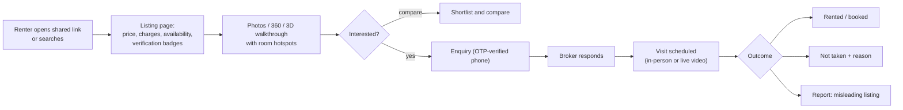

# Rental Product Requirements

Working name: **the platform**. Market: Delhi NCR, starting with Delhi. Categories: PG/co-living, apartments/flats/houses, hotels/short-stay.

## 1. Product principles

1. **Trust before immersion.** A 3D walkthrough of a fake or unavailable listing does harm. Verification, freshness and transparent charges are first-class features.
2. **Facts are structured, marketing is free text.** Rent, deposit, brokerage, availability and verification status come from structured fields and are never parsed from descriptions.
3. **Mobile-first, low bandwidth.** Assume a mid-range Android phone on 4G, viewing through a WhatsApp link.
4. **Graceful degradation.** Every listing works with photos only. 360° and 3D views are progressive enhancements.
5. **Claims require evidence.** "Verified", "measured" and "available" are shown only when backed by a stored check that passed and has not expired.
6. **Category-specific workflows.** PG, flat and hotel each have their own pricing, availability and transaction model (§5).

## 2. Personas

| Persona | Need | Pain today |
|---|---|---|
| **Renter (student / young professional)** looking for a PG | Compare rooms, food and rules remotely. Know the real all-in cost. | Photos don't match reality. Rooms are already taken. Hidden charges. |
| **Renter (family / professional)** looking for a flat | Judge layout, light and condition. Know brokerage up front. Avoid fake brokers. | Wasted site visits. Brokerage surprises. Duplicate and fake listings. |
| **Short-stay guest** | See the actual room category, price for given dates, amenities. | Stock photos. Category mismatch at check-in. |
| **Broker** | Publish fast, share a link on WhatsApp, get qualified leads, schedule visits. | Time spent on unqualified visits. Little trust from renters. |
| **PG operator / property manager** | Keep bed availability current. Fill vacancies. | Calls about rooms that are already full. |
| **Owner** | Control who markets the property and see the enquiries. | Unauthorised brokers listing the property. |
| **Hotel / guesthouse manager** | Show real rooms. Take enquiries or bookings. | Dependence on OTAs and commissions. |
| **Admin / moderator** | Review verifications, resolve reports and disputes with an audit trail. | — |

## 3. Core user journeys

## 4. Functional requirements (shared)

IDs: `FR-<area>-<n>`. Priority: **P1** = MVP1, **P2** = MVP2, **P3** = MVP3, **P4** = MVP4.

### 4.1 Discovery
| ID | Requirement | P |
|---|---|---|
| FR-SRCH-1 | Search by locality (Delhi localities and metro stations), category, budget (all-in monthly or nightly), move-in date / stay dates. | P1 (basic), P3 (date-aware) |
| FR-SRCH-2 | Filters: PG gender, occupancy (single/double/triple), food, furnishing, BHK, pets, brokerage (none / ≤ ½ month / any), verification level, "has 3D tour". | P2–P3 |
| FR-SRCH-3 | Map view with **approximate** pin (≈200 m jitter) until the broker shares the exact address after an enquiry. | P2 |
| FR-SRCH-4 | Shortlist and side-by-side compare of up to 4 listings with a normalised **all-in cost** row. | P2 |

### 4.2 Listing page and viewer
| ID | Requirement | P |
|---|---|---|
| FR-LIST-1 | A shareable, SEO-indexable URL per listing that previews well on WhatsApp (Open Graph image = poster). | P1 |
| FR-LIST-2 | A **price block** rendered from structured data: rent/nightly rate, deposit, brokerage, maintenance, electricity basis, other mandatory charges, all-in estimate. | P1 |
| FR-LIST-3 | An availability block with a last-confirmed timestamp ("Confirmed available 2 days ago by broker"). | P1 |
| FR-LIST-4 | Media: photos (required, ≥ 1 per room), optional walkthrough video, optional 360 panoramas, optional 3D scene. | P1 |
| FR-LIST-5 | An immersive viewer with room labels and hotspots. Details stay accessible alongside the viewer (bottom sheet on mobile, side panel on desktop). | P1 |
| FR-LIST-6 | Floor plan shown only if provided. Dimensions shown only if **validated** (see §6). | P4 |
| FR-LIST-7 | Verification badges link to an explanation of what was checked, when, and by whom (role, not personal identity). | P2 |
| FR-LIST-8 | "Report this listing" on every page. | P1 (simple), P2 (structured) |

### 4.3 Enquiry and visits
| ID | Requirement | P |
|---|---|---|
| FR-ENQ-1 | Enquiry form with phone OTP verification. Fields: move-in date, occupants, budget confirmation, message. | P1 |
| FR-ENQ-2 | The enquiry is delivered to the listing's responsible broker/manager (WhatsApp/SMS/email plus dashboard). | P1 |
| FR-ENQ-3 | Enquiries are tied to the specific listing **and** unit/room. History is retained. | P1 |
| FR-VIS-1 | Visit scheduling: broker proposes slots, renter picks one. States: requested → confirmed → completed / no-show / cancelled. | P2 |
| FR-VIS-2 | Optional live video walkthrough (third-party video SDK or a WhatsApp video call link). | P4 |
| FR-OUT-1 | Rental outcome capture: rented through platform / elsewhere / not rented, plus the reason. Used for freshness and analytics. | P2 |

### 4.4 Broker / manager dashboard
| ID | Requirement | P |
|---|---|---|
| FR-DASH-1 | Create property → units → listing. Upload media. Guided capture checklist. | P1 |
| FR-DASH-2 | One-tap "still available?" confirmation (web plus WhatsApp reply). | P1 |
| FR-DASH-3 | Edit hotspots and room labels on the 3D/360 scene (place a pin, choose a type, write text). | P1 (basic) |
| FR-DASH-4 | Enquiry inbox, visit calendar, outcome logging. | P1 / P2 |
| FR-DASH-5 | Organisation accounts with multiple agents and roles. | P2 |

### 4.5 Admin
| ID | Requirement | P |
|---|---|---|
| FR-ADM-1 | Verification review queue with evidence viewer and approve/reject plus reason. | P2 |
| FR-ADM-2 | Report triage, listing suspension, dispute case management. | P2 |
| FR-ADM-3 | Append-only audit log for every state change on trust objects. | P1 (log), P2 (UI) |

## 5. Category-specific requirements

The three categories differ in **what is rented**, **how it is priced**, **how availability works** and **how the transaction closes**. The table below sets out those differences and the data model follows them (`rental-data-model.md`).

| Dimension | PG / co-living | Apartment / flat | Hotel / short-stay |
|---|---|---|---|
| Rentable unit | **Bed** in a room (or the whole room for single occupancy) | **Whole unit** (sometimes a single room in a shared flat) | **Room type** (inventory count), not a specific room |
| Price basis | Monthly per bed, varies by occupancy (single/double/triple), often includes food | Monthly per unit | Nightly per room type, varies by date, occupancy and meal plan |
| Typical charges | Security deposit (1–2 months), one-time admission/maintenance fee, electricity (metered per room or included), food plan, laundry | Security deposit (commonly 2–3 months in Delhi; **verify per listing**), brokerage (commonly up to 1 month's rent; **must be declared**), society maintenance, electricity/water, parking, lock-in penalty | Taxes (GST slab depends on tariff), extra-bed charge, early check-in/late checkout, refundable incidentals |
| Availability | Per bed: available-from date, notice period, held/reserved | Per unit: available-from date, lease term, lock-in | Per date × room type: count available, min stay, closed-to-arrival |
| Rules | Gender (male/female/co-ed), visitor policy, curfew, food (veg/non-veg), smoking/alcohol, notice period | Tenant preference (family/bachelor: show only as the owner's stated policy, see §7), pets, furnishing, lease duration | Check-in/out times, ID requirements, couple policy, cancellation policy |
| Transaction | Enquiry → visit → token amount → move-in. Bed allocation. | Enquiry → visit → negotiation → token → agreement (rent agreement, police verification) → move-in | Instant booking (if integrated) or enquiry → quote → pay at property |
| Freshness requirement | High: beds turn over weekly. Reconfirm every **7 days**. | Medium: reconfirm every **14 days**. | Real-time if integrated, otherwise reconfirm **daily** or show "enquire for availability". |
| Media focus | Each room type **and** common areas (kitchen, washrooms, dining, terrace) | All rooms, kitchen, bathrooms, balcony, view, building entrance, parking | Each room category, bathroom, lobby, dining |

### 5A. PG and co-living
| ID | Requirement | P |
|---|---|---|
| FR-PG-1 | A Property contains Rooms. Each Room has a sharing type (1/2/3/4+), bed count, attached/common bath, AC/non-AC, floor, and its **own media/scene**. | P3 (P1 supports a single "PG" listing with room types as text-free structured fields) |
| FR-PG-2 | Bed-level availability: each bed is `vacant / occupied / notice_given(date) / reserved(until)`. The listing shows "2 beds available in double-sharing from 1 Nov". | P3 |
| FR-PG-3 | Pricing per sharing type and AC option. Food plan included/optional (meals/day, veg/non-veg). Deposit, one-time fees, electricity basis. | P1 (structured), P3 (per room) |
| FR-PG-4 | Amenities: Wi-Fi (speed if known), laundry, housekeeping frequency, security (guard, CCTV, biometric), power backup, water purifier, fridge, gym. | P1 |
| FR-PG-5 | House rules: gender, visitors, curfew, notice period, lock-in, smoking/alcohol, pets. | P1 |
| FR-PG-6 | Move-in date and "earliest available bed" are computed from bed states. | P3 |

### 5B. Apartments and flats
| ID | Requirement | P |
|---|---|---|
| FR-APT-1 | Unit attributes: BHK, carpet/super area (labelled "as declared" unless validated), floor/total floors, facing, furnishing (unfurnished/semi/fully plus an item checklist), bathrooms, balconies, parking, lift, power backup, water supply. | P1 |
| FR-APT-2 | Room-level views: bedroom(s), bathroom(s), kitchen, living, balcony, each a labelled zone/hotspot in the walkthrough. | P1 |
| FR-APT-3 | Charges: monthly rent, deposit (amount or months), brokerage (amount / months / "no brokerage"), maintenance (included or amount), electricity/water basis, one-time charges. | P1 |
| FR-APT-4 | Lease: available-from, minimum lease, lock-in, notice period, rent escalation % (if stated), agreement type (11-month / registered). | P1 |
| FR-APT-5 | Building facilities: security, lift, power backup, parking, society/RWA rules. | P1 |
| FR-APT-6 | Floor plan and room dimensions **only** when they pass measurement validation (§6). | P4 |

### 5C. Hotels and short-stay
| ID | Requirement | P |
|---|---|---|
| FR-HTL-1 | Room categories (Standard / Deluxe / Suite …) with max occupancy, bed configuration, size (validated or "as declared"), amenities, and a walkthrough per category. | P3 |
| FR-HTL-2 | Date-based availability and nightly rate per category. Applicable taxes shown separately. Extra-person charges. | P3 |
| FR-HTL-3 | Check-in/out times, ID policy, cancellation policy. | P3 |
| FR-HTL-4 | Booking mode per property: **enquiry only** (default), **deep link** to the hotel's own booking engine, or **API integration** with a channel manager (later; see `system-architecture.md`). | P3 / P4 |
| FR-HTL-5 | The scene is tagged as "representative room of this category". When a specific room cannot be guaranteed, the UI says so. | P3 |

## 6. Measurement and floor-plan honesty rules

- **R-MEAS-1:** Show a numeric dimension only if `measurement.validation_status = validated`: produced from metric-scale geometry (LiDAR / RoomPlan / dedicated scanner, or a scale-referenced capture) **and** spot-checked against a physical tape/laser reference within tolerance (default ±2% or ±5 cm, whichever is larger).
- **R-MEAS-2:** Owner-declared areas are labelled "as declared by owner/broker". They are never presented as measured.
- **R-MEAS-3:** The 3D viewer's measurement tool is **disabled** for scenes without validated scale.
- **R-MEAS-4:** Floor plans carry a "schematic, not to scale" label unless validated.

## 7. Compliance and fairness requirements (to confirm with counsel)

- Phone-based identity with OTP. Minimal personal data. DPDP-aligned notice and consent, with retention limits (E71).
- Never store raw Aadhaar numbers. Use consented KYC via licensed providers and store references or masked values (E74).
- **Exposure of exact addresses** is controlled (for PGs especially, for occupant safety).
- **Privacy in captures**: no people, no identifiable documents or photographs of occupants. Occupant consent is required for occupied units. Automated face blurring before publication (P2).
- **Tenant-preference fields** (e.g. "family only", gender for PGs) are shown only as the owner's stated policy, factually. Discriminatory text (religion, caste, food habits used to exclude, etc.) is blocked in free-text moderation. Policy to be reviewed with counsel.
- Remind renters of police-verification and rent-agreement obligations (E72). The platform does not perform police verification in the MVP.

## 8. Non-functional requirements

| ID | Requirement | Target |
|---|---|---|
| NFR-1 | Listing page first contentful paint on 4G (mid-range Android) | ≤ 2.5 s p75 |
| NFR-2 | Time from tapping "Open 3D tour" to the first interactive coarse view on 4G | ≤ 8 s p75 |
| NFR-3 | 3D viewer frame rate on the reference mid-range Android | ≥ 30 fps median, ≥ 24 fps p10 |
| NFR-4 | Data per 3D tour session (first room) | ≤ 25 MB p75. Whole tour ≤ 80 MB. |
| NFR-5 | Fallback when WebGL2 is unavailable, the device is low-memory or the scene fails | Photos/360 shown within 1 s of detection. No blank screen. |
| NFR-6 | Capture-to-publish (photos only) | ≤ 15 min of broker time |
| NFR-7 | Capture-to-publish (3D) | median ≤ 6 h, p95 ≤ 24 h |
| NFR-8 | Availability of listing pages | 99.5% monthly |
| NFR-9 | Accessibility | WCAG 2.1 AA for listing pages. The 3D viewer always has a non-3D alternative. |
| NFR-10 | Languages | English and Hindi UI (P2) |
