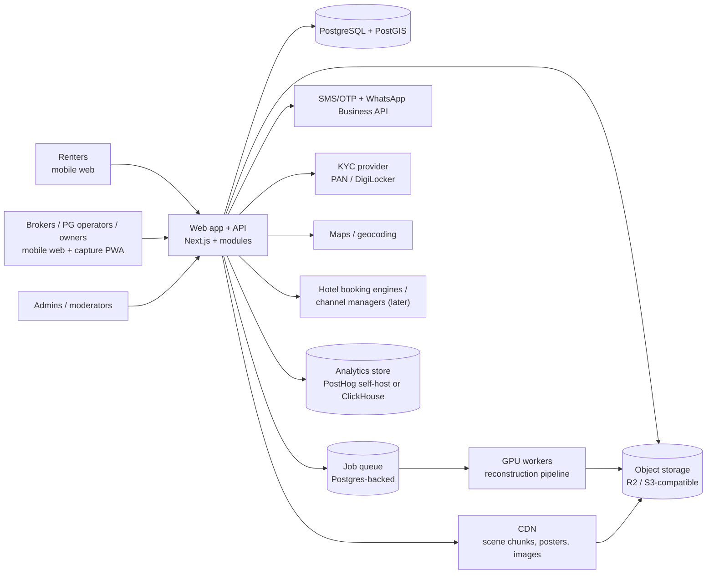
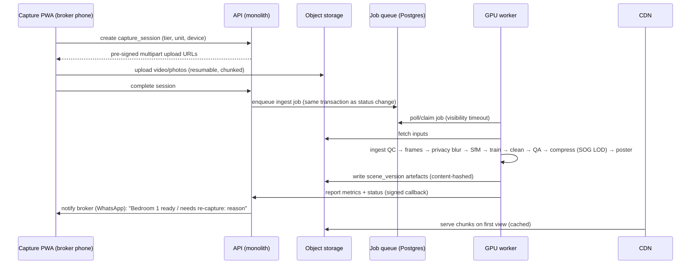

# System Architecture

Recommendation: a **modular monolith** (one deployable API/web app plus a separate GPU worker pool) on **TypeScript + PostgreSQL**, with object storage that has **zero or low egress**, built from boring, widely-hired technology. Split into services only when a module has a different scaling or availability profile. The GPU pipeline already does.

## 1. Context

## 2. Modules (inside the monolith)

| # | Module | Responsibilities | Key dependencies |
|---|---|---|---|
| 1 | **Discovery** | Search, filters, map, shortlist, compare | Postgres (PostGIS + full-text + trigram). Move to OpenSearch/Meilisearch only beyond ~100k listings. |
| 2 | **Listing pages + viewer** | SSR listing page, OG images, viewer bundle, embed | Next.js SSR/ISR, CDN |
| 3 | **Lister dashboard** | Properties, units, listings, pricing, availability, hotspot editor, inbox | — |
| 4 | **Capture & processing** | Upload sessions (resumable), ingest checks, job orchestration, scene versions | Queue, GPU workers, object storage |
| 5 | **Trust** | Verification checks, authorisations, duplicate detection, freshness scheduler, reports | KYC provider, perceptual hashing, scheduler |
| 6 | **Engagement** | Enquiries, message relay, visits, outcomes, notifications | WhatsApp/SMS provider |
| 7 | **Hotels** | Room types, nightly inventory, booking requests, integration adapters | Channel-manager / booking-engine APIs (later) |
| 8 | **Moderation & admin** | Queues, cases, decisions, audit viewer | Audit log |
| 9 | **Analytics** | Event ingestion, funnels, listing performance, pipeline cost dashboards | PostHog / ClickHouse |

Module boundaries are enforced in code: separate folders, a public interface per module, no cross-module table access except through that interface. Lint rules check this.

## 3. Technology choices

| Concern | Recommendation | Alternatives | Why |
|---|---|---|---|
| Frontend | **Next.js (React, App Router)**, TypeScript, Tailwind | Remix, SvelteKit | SSR for SEO and WhatsApp previews. Huge hiring pool in India. Nucleus also uses Next.js (E20). |
| 3D | **three.js + Spark** (lazy-loaded). PlayCanvas engine as the benchmark fallback. **Photo Sphere Viewer** for 360. | — | MIT, proven (E28, E53, E54, E58) |
| Backend | **Node.js/TypeScript** inside the Next.js app (route handlers) for MVP 1. Extract a **NestJS/Fastify** API when the dashboard and mobile app need a stable API (MVP 2). | Django/FastAPI (Python) | One language across web and API. Python is reserved for the GPU pipeline. |
| Database | **PostgreSQL 16 + PostGIS + pg_trgm**, managed | — | Relational integrity for trust data, geo search, trigram dedupe |
| ORM / migrations | Drizzle or Prisma, plus SQL migrations reviewed by hand for constraints and triggers | — | |
| Object storage | **Cloudflare R2** (zero egress, $0.015/GB-mo, E62) for published scene chunks, posters and images. Raw uploads in R2 or S3 with lifecycle rules. | AWS S3 (ap-south-1) + CloudFront | 3D tours are egress-heavy. Zero egress removes the largest variable cost. |
| CDN | Cloudflare in front of R2 (custom domain). Immutable content-hashed keys. | CloudFront | |
| Queue / background jobs | **Postgres-backed queue (pg-boss or Graphile Worker)** for app jobs (notifications, freshness, dedupe). The same queue dispatches GPU jobs to workers that poll. | Redis + BullMQ, AWS SQS, Temporal (later) | No extra infrastructure in the MVP. Transactional enqueue with business writes. |
| GPU workers | Python container: ffmpeg, OpenCV, GLOMAP/COLMAP, **gsplat** (or Brush), splat-transform (Node CLI). **On-demand GPU** (NVIDIA L4 class) from an India provider (E2E Networks, ~₹49/hr, E63) or a global spot/serverless GPU (RunPod/Modal). Autoscale from 0. | AWS g6 (L4) in ap-south-1 | Pay per scene. No idle GPUs. |
| Auth | Phone OTP (MSG91 / Twilio Verify / Gupshup), session cookies, RBAC with org scoping | Firebase Auth, Supabase Auth | Indian users expect OTP. |
| Messaging | **WhatsApp Business Platform** (via a BSP such as Gupshup/Interakt/Twilio) for enquiry alerts and the "still available?" reconfirm, plus SMS fallback | — | Brokers live on WhatsApp. |
| KYC | A licensed Indian KYC aggregator for PAN verification and DigiLocker-consented document fetch. **Never store raw Aadhaar.** | Manual document review only | E74 |
| Maps | Google Maps Platform or Ola/Mappls for geocoding and locality boundaries | OSM + Nominatim (self-host) | Locality accuracy in Delhi |
| Analytics | **PostHog** (self-host or cloud), with event schemas in the viewer doc | Plausible + ClickHouse | Funnels, feature flags. Nucleus uses PostHog too (E38). |
| Observability | OpenTelemetry → Grafana Cloud / Sentry for front-end errors (WebGL failures) | — | Viewer fallbacks must be visible. |
| Hosting | **Containers on a single cloud region near Delhi**: AWS ap-south-1 (Mumbai) or ap-south-2 (Hyderabad), or Indian clouds (E2E/Yotta) for cost. Vercel is possible for the web tier, but region and data-location control favour self-managed containers (ECS/Fargate or Fly/Render) for DPDP comfort. | Vercel + Neon/Supabase for fastest MVP | Data stays in India by default (not strictly mandated, but simpler for compliance conversations). |
| IaC / CI | Terraform + GitHub Actions. Preview environments per PR. | — | |

## 4. Capture and processing pipeline (deployment view)

Reliability:
- Each stage is idempotent and checkpointed to object storage. A retry resumes from the last finished stage.
- Jobs carry a **cost cap**: max GPU minutes per zone. When it is exceeded, the job fails with `cost_cap` and the zone falls back to T1.
- A poison-job quarantine after 3 attempts, with alerts.

## 5. Hotel integration approach

| Phase | Mode | Notes |
|---|---|---|
| MVP 3 | **Enquiry only**: room type + dates + guests → the hotel replies with a quote via dashboard/WhatsApp | No inventory sync risk |
| MVP 3+ | **Deep link** to the hotel's own booking engine with dates prefilled | Availability is shown as "check live price" |
| MVP 4 | **Channel-manager / booking-engine API** adapter (rates and availability pull, booking push) for 1–2 providers popular with Indian independent hotels | Provider choice and API access terms are **unknown** (see `unknowns-and-risks.md`). An adapter interface isolates this. Payments are handled by the hotel or a PCI-compliant gateway, **never stored by us**. |

## 6. Security and privacy architecture

- **Data classes:** public (listing facts, published media), restricted (exact address, owner contacts, renter phones), sensitive (KYC evidence, documents). Sensitive data goes in a separate bucket with KMS encryption, short-lived pre-signed URLs and per-access audit events.
- **PII minimisation:** relay messaging and masked numbers. Renter phone numbers are revealed to the broker only after an enquiry. Exact addresses are revealed only after a confirmed visit (configurable per listing).
- **Media privacy:** EXIF/GPS stripped from public derivatives. Face and person blur in the pipeline. Documents and IDs are detected in photos and blocked from publication.
- **DPDP alignment (E71):** a purpose-specific consent notice at signup and at enquiry, data-principal request handling (access, correction, erasure), a retention schedule (e.g. raw capture video 90 days after publication; KYC evidence per policy; enquiries 2 years), breach runbook with 72 h reporting, and processing logs kept ≥ 1 year.
- **AuthZ:** org-scoped RBAC. Admin actions require a reason and are audit-logged. A four-eyes rule for verification overrides.

## 7. Environments and deployment

- `dev` (local Docker Compose: Postgres+PostGIS, MinIO, worker with a CPU-only "mock reconstruct" stage), `staging` (full stack, small GPU quota), `prod`.
- Blue/green deploy for the web tier. Migrations are backward-compatible (expand → migrate → contract).
- Pipeline versioning: each `scene_version` records the pipeline image digest, so a scene can be reproduced.

## 8. Alternatives considered

| Alternative | Why not now |
|---|---|
| Microservices from day 1 | Team size and MVP scope don't justify the operational overhead. |
| Firebase/Supabase-only backend | Trust data needs strict relational constraints, append-only audit and a custom state machine. Possible for MVP 1 speed, but likely needs migrating later. |
| Licensing Nucleus-like hosted tours | No public pricing (E12). US-centric. Dedicated hardware. We would still need the whole listing and trust layer. Worth a partnership conversation for premium hotels. |
| Hosted splat streaming (splatter.app) | Good bridge (E52), but per-scene pricing and lock-in. Self-hosted streamed SOG on R2 is cheap and open. |
