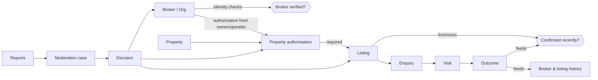
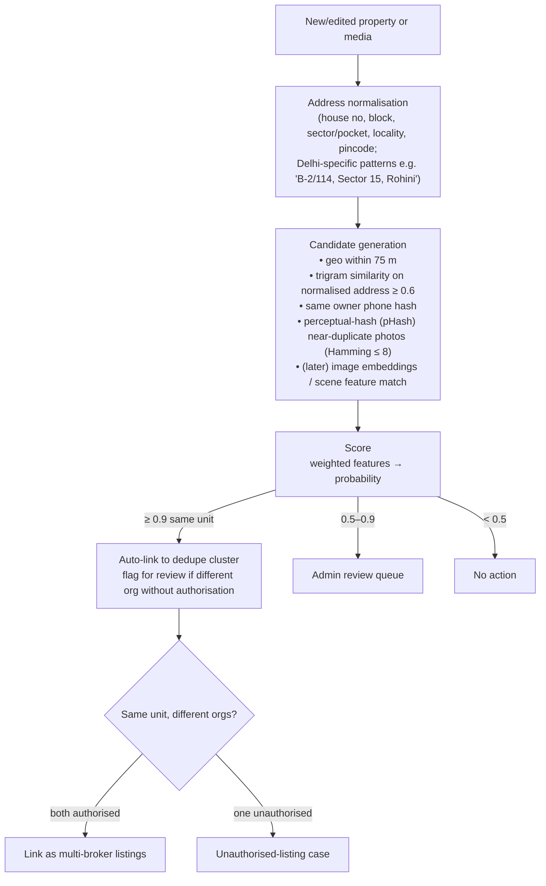
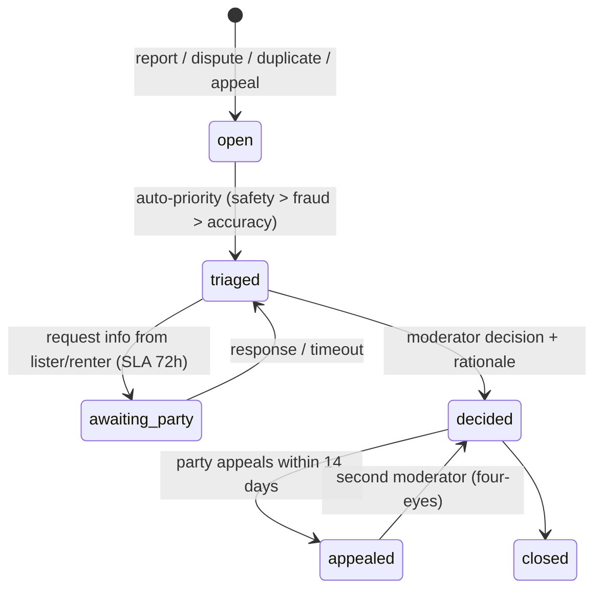

# Verification and Trust Design

Aim: renters can tell **what has been checked, by whom, and how recently**, kept separate from what the lister *claims*. A badge appears only when a specific check passed and is still valid. Nothing on the platform is described as "verified" in general terms.

> Legal note: Indian regulatory points (RERA scope for rental brokers, Aadhaar handling, DPDP, police verification) are summarised from secondary sources (E70–E74) and **must be reviewed by counsel** before launch.

## 1. Trust chain

## 2. Check catalogue

Each check is a row in `verification_checks` with `status`, `method`, `expires_at` and evidence. Badges map to **sets** of checks.

### 2.1 Person / broker / organisation
| Check type | How | Automated? | Expiry | Notes |
|---|---|---|---|---|
| `phone_otp` | OTP to a mobile number | Yes | Re-verify on number change | Baseline for every account |
| `pan_verified` | PAN plus name match through a licensed KYC provider | Yes (provider) | 2 years | Store PAN masked (`ABCDE****F`) plus the provider reference |
| `identity_digilocker` | DigiLocker-consented fetch of an identity document (name, photo, DOB match) | Yes (provider), manual on mismatch | 2 years | Store **no Aadhaar number**. Masked reference only (E74). |
| `selfie_liveness_match` | Liveness plus face match with the ID photo | Yes (provider) | 2 years | Optional, used for brokers with complaints history |
| `business_registration` | GSTIN lookup / shop & establishment certificate | Semi | 1 year | For brokerages and PG operators that have them |
| `rera_agent_registration` | Delhi RERA agent number, checked manually on the RERA portal | Manual | Until the RERA expiry date | Shown when present. **Not required** for rental-only brokers unless counsel says otherwise (E70). |
| `office_address` | Document plus geo-tagged photo of the office, or a field visit | Manual | 1 year | Optional (P3) |

**Badge "ID-checked broker"** = `phone_otp` + `pan_verified` + `identity_digilocker`, all passed and unexpired.

### 2.2 Property and authorisation
| Check type | How | Automated? | Expiry |
|---|---|---|---|
| `owner_contact_confirmation` | The platform calls/OTPs the **owner's** number (entered by the broker, then validated against the ownership document name where possible). The owner confirms: "Broker X may list Flat 3B, rent ₹Y, until date." | Semi (an IVR/WhatsApp flow, manual call fallback) | Per authorisation term (≤ 6 months) |
| `ownership_document` | One of: property tax receipt, electricity bill in the owner's name, registered sale deed (first page), registered lease plus sublet permission (operators). OCR for name/address match. Human review. | Semi | 1 year |
| `operator_lease` | For PG operators and serviced apartments that lease from owners: a lease page showing the operator as lessee for the address | Manual | Until the lease end |
| `hotel_registration` | GSTIN plus a trade licence / tourism registration, where applicable | Manual | 1 year |
| `onsite_capture_consistency` | The capture session's device GPS (on the capture device, not EXIF of uploaded files) and timestamp fall within ~150 m of the property pin. Photos come from in-app capture, not the gallery. | Yes | Per capture |
| `address_match` | The geocoded pin is consistent with the document address (locality/pincode). | Yes plus manual on conflict | — |

**Badge "Owner-authorised listing"** = an `active` authorisation with `owner_contact_confirmation` passed **and** (`ownership_document` **or** `operator_lease` **or** `hotel_registration`) passed.

**Badge "Photos taken on-site"** = media from capture sessions with `onsite_capture_consistency` passed, all taken within the last N days (PG 60, flats 90).

### 2.3 Listing
| Check type | How | Expiry |
|---|---|---|
| `charges_disclosed` | Deposit and brokerage rows present (brokerage can be "none"). No price-like numbers in free text that conflict with structured data. | Each edit |
| `availability_confirmed` | The lister reconfirmed (web/WhatsApp one-tap) | PG 7 d, flat 14 d, hotel 1 d or integration |
| `media_freshness` | The newest capture is younger than the threshold | 90 d |
| `content_moderation` | Text moderation: no discriminatory terms, no contact details in text, no misleading claims ("verified", "no brokerage" when a brokerage row exists) | Each edit |

## 3. Display rules

- A badge is shown only from derived check state, computed server-side, never from listing fields.
- Every badge is tappable and shows: **what was checked**, **when**, **valid until**, and **what was NOT checked**. For example: "We did not inspect the property in person."
- Missing checks are shown neutrally ("Owner authorisation: not yet confirmed"). They are not hidden, and they are not shown as negative accusations.
- Marketing copy cannot contain "verified", "genuine", "100%" or similar terms. The moderation filter blocks them.
- If any required check expires, the badge disappears **automatically** at `expires_at` (a scheduled job plus query-time filter, both kept as defence-in-depth).

## 4. Multiple brokers, one property

- A property can have several **non-exclusive** authorisations. Each authorised org can publish its own listing for the same unit.
- On the listing page: "Also offered by 2 other authorised brokers", with a comparison of their brokerage. This rewards transparency.
- An **exclusive** authorisation (owner-confirmed) blocks other orgs from publishing that unit. Existing listings get a moderation case.
- A listing by an org **without** authorisation for a unit already exclusively authorised to another org is auto-blocked with a `unauthorised_listing` case.

## 5. Duplicate-property detection

Goal: cluster listings that refer to the same physical place without merging distinct units in the same building.

- Re-used photos across *different addresses* is a strong fraud signal (stolen photos), so a pHash match with a geo mismatch raises a case.
- Merges are reversible: a `merged_into` status plus an `unmerge` decision. They are always audit-logged.

## 6. Freshness management

| Category | Reconfirm cadence | Reminder channel | Stale → hidden | Auto-expire |
|---|---|---|---|---|
| PG | 7 days | WhatsApp "Still 2 beds free in double sharing? [Yes] [Update] [Full]" | +2 days | +7 days |
| Flat | 14 days | WhatsApp / SMS | +3 days | +14 days |
| Hotel (enquiry mode) | daily, or show "ask for availability" | Dashboard | — | — |

Additional signals:
- A renter outcome `listing_unavailable` or a report `not_available` → immediate `needs_reconfirm`. Two independent reports in 72 h → auto-pause until the lister reconfirms.
- The page shows "Last confirmed available: 3 days ago by broker" with the actor **role**.
- A broker freshness score = share of their listings confirmed on time and renter-reported availability accuracy, shown on the broker profile after enough data (≥ 10 outcomes).

## 7. Enquiry and visit records (trust evidence)

- Every enquiry stores a **price snapshot**: the structured charges as shown at that moment. Disputes about changed brokerage or deposit can be checked objectively.
- Visits have explicit states and **both-sided outcomes**: a renter can mark "lister no-show", and a lister can mark "renter no-show".
- Message relay logs are retained per policy (dispute window, e.g. 180 days).

## 8. Reporting, moderation and disputes

- SLAs (targets): safety reports first action in **4 h**, fraud/unauthorised in **24 h**, accuracy in **72 h**.
- Interim actions: a listing can be **paused pending review** without accusing anyone publicly.
- Decisions are immutable, linked to evidence, and visible to the affected party with a rationale.

## 9. Histories and scores

- **Listing history** (public summary): created, price changes (dates and directions), availability changes, verification changes.
- **Broker history** (public summary after a threshold): active since, number of listings, response-time median, freshness score, upheld reports count (only **upheld**, never raw complaints).
- **Property history** (internal): all listings, authorisations, disputes and media versions.

## 10. Audit trail

- Append-only, hash-chained `audit_events` (see the data model). A daily anchor hash is written to a separate write-once store (e.g. an object-lock bucket).
- Covered actions: every change to authorisations, verification checks, listing status, price plans and charges, availability, moderation decisions, admin access to sensitive evidence.
- Admin tooling shows the chain for any subject and verifies integrity on read.

## 11. Threat model (abbreviated)

| Threat | Control |
|---|---|
| Fake broker posts stolen photos of someone else's flat | pHash across the corpus, in-app capture requirement for the "on-site" badge, owner confirmation for the "authorised" badge |
| Bait listing (low price, "just rented, see these others") | Freshness reconfirm, renter `listing_unavailable` outcomes, price snapshot, broker score |
| Hidden charges | Mandatory structured brokerage and deposit, text moderation for conflicting numbers, enquiry snapshot |
| Owner unaware their property is marketed | Owner confirmation, plus an owner claim flow ("Is this your property?") that creates an exclusive authorisation |
| Badge spoofing in images/text | Badges only rendered by the UI from check state. Moderation of text and images. |
| Insider misuse of KYC data | Separate encrypted store, access audit, four-eyes for overrides, retention limits |
| Renter safety (exact PG address exposed) | Approximate pin until an enquiry or confirmed visit. Report → priority queue. |
